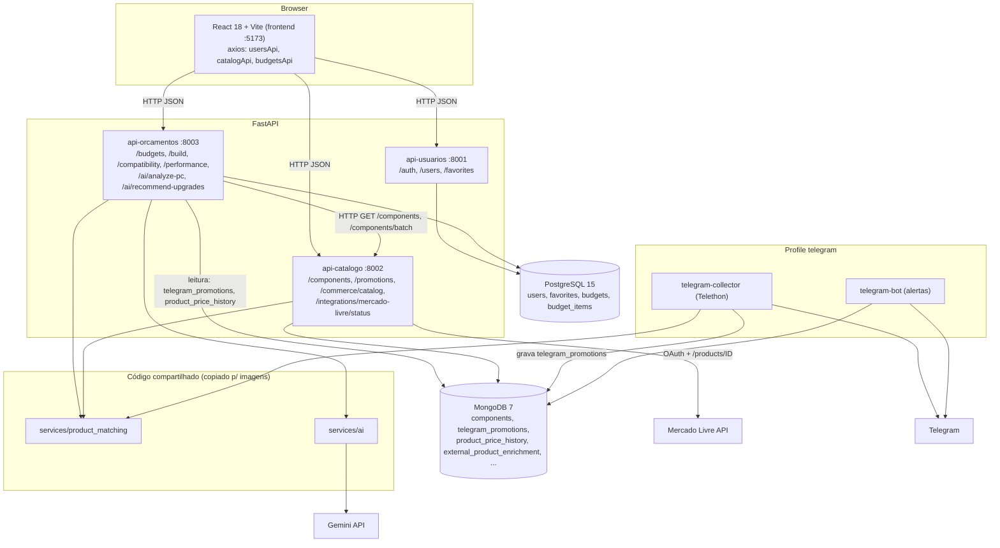
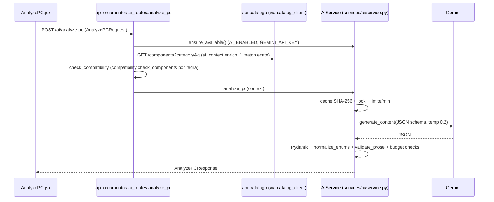
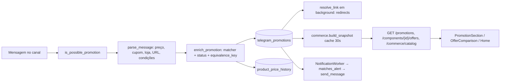
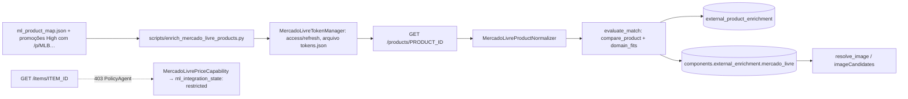
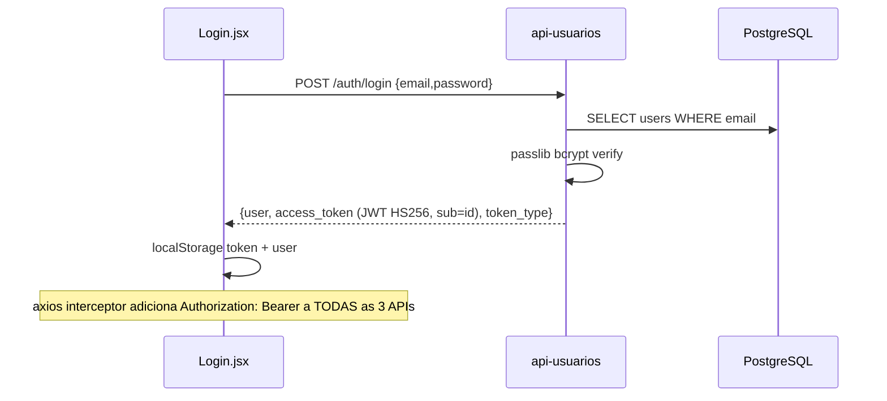

# PC2YOU — Arquitetura (engenharia reversa)

> Fonte de verdade: o **código** em `PC2YOU/` (inspeção read-only em 2026-11-04). Nenhum arquivo do projeto foi alterado; só estes documentos foram criados.
> Nenhum segredo é reproduzido: apenas **nomes** de variáveis.

## 1. Visão geral

PC2YOU é uma plataforma de hardware de PC com quatro frentes:

1. **Catálogo técnico** de 121 componentes (seed em `api-catalogo/seed.py`, MongoDB) com especificações, compatibilidade e benchmarks.
2. **Comércio real**: ofertas coletadas de canais do **Telegram** (Telethon), interpretadas por parser determinístico, associadas ao catálogo pelo **Product Matcher** e avaliadas por um modelo de status comercial (`announced/conditional/confirmed/stale/expired/invalid`). Preços do seed **não** são mostrados como preço atual.
3. **Montagem / orçamento** (`/build`): wizard passo a passo com motor de compatibilidade e estimativa de desempenho; orçamentos salvos exigem login (PostgreSQL).
4. **IA (Gemini)**: `POST /ai/analyze-pc` (diagnóstico + prioridades) e `POST /ai/recommend-upgrades` (substituições + ofertas). A IA só escolhe IDs entre candidatos calculados pelo backend; compatibilidade e preços **nunca** vêm do modelo.

Complementos: **Mercado Livre** (Product API para imagens/specs oficiais; Item/Price API restrita por 403), **bot Telegram** de alertas de preço (python-telegram-bot), scripts de manutenção/auditoria em `scripts/`.

## 2. Serviços e containers (de `docker-compose.yml`)

| Serviço | Container | Porta host→container | Imagem / build | Depende de | Volumes | Variáveis relevantes (nomes) |
|---|---|---|---|---|---|---|
| `postgres-db` | `orcapc_postgres` | 5432→5432 | `postgres:15` | — | `postgres_data` | `POSTGRES_USER`, `POSTGRES_PASSWORD`, `POSTGRES_DB` |
| `mongo-db` | `orcapc_mongo` | 27017→27017 | `mongo:7` | — | `mongo_data` | — |
| `api-usuarios` | `orcapc_api_usuarios` | 8001→8000 | build `./api-usuarios` (python:3.12-slim) | postgres-db (healthy) | — | `POSTGRES_*`, `JWT_SECRET`, `JWT_ALGORITHM`, `ACCESS_TOKEN_EXPIRE_MINUTES`, `CORS_ORIGINS` |
| `api-catalogo` | `orcapc_api_catalogo` | 8002→8000 | build ctx `.` / `api-catalogo/Dockerfile` (copia `services/product_matching/` → `./product_matching/`) | mongo-db (healthy) | `ml_tokens:/data/ml` | `MONGO_URI`, `MONGO_DB`, `MERCADO_LIVRE_*`, `PC2YOU_ML_PRODUCT_CACHE_TTL_HOURS`, `JWT_SECRET`, `ADMIN_API_KEY`, `CATALOG_MAX_*`, `IMAGE_PROXY_*`, `ML_*_TIMEOUT`, `REFRESH_COOLDOWN_SECONDS`; também `env_file: .env` |
| `api-orcamentos` | `orcapc_api_orcamentos` | 8003→8000 | build ctx `.` / `api-orcamentos/Dockerfile` (copia `services/ai/` → `./ai/` e `services/product_matching/`) | postgres-db, api-catalogo, api-usuarios (todos healthy) | — | `POSTGRES_*`, `CATALOG_API_URL`, `MONGO_URI`, `MONGO_DB`, `JWT_*`, `CATALOG_*`, `AI_ENABLED`, `GEMINI_API_KEY`, `GEMINI_MODEL`, `AI_TIMEOUT_SECONDS`, `AI_CACHE_TTL_SECONDS`, `AI_REQUESTS_PER_MINUTE`, `AI_DEBUG_VALIDATION` |
| `frontend` | `orcapc_frontend` | 5173→5173 | build `./frontend` (node:22-alpine, `npm run dev -- --host`) | as 3 APIs (healthy) | — | `VITE_USERS_API_URL`, `VITE_CATALOG_API_URL`, `VITE_BUDGETS_API_URL` |
| `telegram-collector` | (sem nome fixo) | — | build `./services`; CMD `python -m services.telegram_collector.collector listen --import-history` | mongo-db | `telegram_sessions:/data/telegram` | `TELEGRAM_API_ID`, `TELEGRAM_API_HASH`, `TELEGRAM_PHONE`, `TELEGRAM_ALLOWED_CHATS`, `TELEGRAM_HISTORY_LIMIT`, `TELEGRAM_SESSION_PATH` |
| `telegram-bot` | (sem nome fixo) | — | build `./services`; `python -m services.telegram_bot.bot` | mongo-db | — | `TELEGRAM_BOT_TOKEN`, `TELEGRAM_ALLOWED_CHATS`, `TELEGRAM_ALLOWED_USERS`, `TELEGRAM_ALERT_DEDUP_HOURS`, `TELEGRAM_NOTIFICATION_POLL_SECONDS` |

- `telegram-collector` e `telegram-bot` estão no **profile `telegram`** (só sobem com `--profile telegram`).
- Volumes nomeados: `postgres_data`, `mongo_data`, `telegram_sessions`, `ml_tokens`. Rede: `orcapc-network` (bridge).
- Healthchecks: `/health/live` das 3 APIs; `pg_isready`; `mongosh ping`.
- Imports cruzados: o código compartilhado (`services/ai`, `services/product_matching`) é **copiado** para dentro das imagens das APIs; localmente é achado via `sys.path.append(<repo>/services)` (ex.: `api-orcamentos/ai_routes.py:10`, `api-catalogo/ml_service.py:4`).

## 3. Bancos

| Banco | Quem usa | Para quê |
|---|---|---|
| **MongoDB 7** (`orcapc_catalog`) | api-catalogo, api-orcamentos (somente leitura de promoções), telegram-collector, telegram-bot, scripts | catálogo, promoções, histórico de preços, enriquecimento ML, alertas, estado do coletor |
| **PostgreSQL 15** (`orcapc_db`) | api-usuarios (tabelas `users`, `favorites`), api-orcamentos (tabelas `budgets`, `budget_items`; lê `users` por SQL cru) | contas, favoritos, orçamentos |

Detalhes em [DATABASE_MAP.md](DATABASE_MAP.md).

## 4. Integrações externas

| Integração | Onde | Obrigatória? |
|---|---|---|
| Gemini (`google-genai==1.30.0`, modelo padrão `gemini-2.5-flash`) | `services/ai/provider.py` | Só para `/ai/*`; desligada por padrão (`AI_ENABLED=false`) |
| Telegram MTProto (Telethon 1.45) | `services/telegram_collector/` | Só para alimentar promoções |
| Telegram Bot API (python-telegram-bot 22.8) | `services/telegram_bot/` | Só para alertas |
| Mercado Livre (`api.mercadolibre.com`) | `api-catalogo/ml_products.py`, `ml_commerce.py`, `ml_service.py` | Opcional; falhas nunca derrubam o catálogo |
| Lojas (HTTP GET sem corpo, só redirects) | `services/product_matching/destinations.py` | Opcional (best effort) |

## 5. Diagrama de arquitetura (gerado a partir do código)



Observações verificadas no código:
- `api-orcamentos` **não** chama `api-usuarios` por HTTP; valida o JWT localmente (mesmo `JWT_SECRET`) e confere o usuário com `SELECT 1 FROM users` no **mesmo Postgres** (`services.ensure_user_exists`).
- `api-catalogo` valida JWT localmente (sem banco) e usa `X-Admin-Key` para rotas administrativas.
- O frontend fala **direto** com as três APIs (CORS), não há gateway.

## 6. Fluxos de dados (diagramas separados)

### 6.1 Análise de PC

### 6.2 Telegram → promoção → frontend

### 6.3 Mercado Livre

### 6.4 Login


## 7. Inventário relevante (árvore resumida)

Ignorados: `node_modules`, `.venv*`, `services/.venv`, `__pycache__`, `.pytest_cache`, `dist`, `reports/*.json` (artefatos de auditoria), `docs/*.md` antigos (lidos apenas para comparar).

```
PC2YOU/
├─ docker-compose.yml  .env.example  README.md
├─ api-usuarios/   main.py auth.py crud.py models.py schemas.py config.py database.py entrypoint.sh alembic/ tests/
├─ api-catalogo/   main.py commerce.py services.py schemas.py database.py dependencies.py config.py seed.py
│                  ml_products.py ml_commerce.py ml_service.py ml_product_map.json
│                  catalog_enrichment_*.json seed_identity_*.json  tests/
├─ api-orcamentos/ main.py ai_routes.py ai_context.py ai_upgrade_context.py promotion_source.py catalog_client.py
│                  compatibility.py performance.py services.py models.py schemas.py auth.py settings.py entrypoint.py alembic/ tests/
├─ services/
│  ├─ ai/                  service.py provider.py prompts.py schemas.py upgrades.py upgrade_schemas.py contract.py prose.py config.py errors.py diagnostics.py
│  ├─ product_matching/    matcher.py normalization.py promotions.py offers.py quality.py destinations.py ml_ids.py reporting.py
│  ├─ telegram_collector/  collector.py parser.py links.py filters.py deduplication.py matcher.py repository.py config.py models.py
│  ├─ telegram_bot/        bot.py handlers.py alerts.py notifier.py
│  ├─ catalog_audit/ catalog_enrichment/   (ferramentas de auditoria/sync do seed)
│  └─ tests/               (485 testes coletados)
├─ frontend/src/  App.jsx api.js pages/{Home,Login,Register,ComponentDetails,Favorites,Build,BudgetResult,AnalyzePC} components/ utils/
└─ scripts/        sync_*, enrich_mercado_livre_products, backfill_promotion_conditions, reprocess_product_matches, resolve_promotion_links, audit_*, telegram_demo, ai_*_demo
```

## 8. Documentação módulo a módulo

| Módulo | Responsabilidade | Entrada | Principais arquivos/funções | Consumido por | Depende de | Banco | Externo |
|---|---|---|---|---|---|---|---|
| `api-usuarios/` | contas, login JWT, favoritos | `main.py` (`uvicorn main:app`; `entrypoint.sh` roda `alembic upgrade head`) | `crud.create_user/verify_password`, `auth.create_access_token/get_current_user/require_owner` | frontend | PostgreSQL | PG | — |
| `api-catalogo/` | catálogo técnico + leitura comercial + integração ML | `main.py` (startup: `ensure_indexes`, `seed_components`) | `services.list_components/_public_component/price_summary`, `commerce.build_snapshot/best_offer/dedupe`, `ml_products.*` | frontend, api-orcamentos | MongoDB, `product_matching` | Mongo | Mercado Livre |
| `api-orcamentos/` | orçamentos, wizard de montagem, compatibilidade, desempenho, **IA** | `main.py` + `ai_routes.router` (`entrypoint.py` roda alembic e uvicorn) | `compatibility.check_components/next_category`, `performance.estimate_performance`, `services.create_or_update_budget`, `ai_context.build_context`, `ai_upgrade_context.build_upgrade_bundle` | frontend | api-catalogo (HTTP), PG, Mongo (read), `ai`, `product_matching` | PG + Mongo | Gemini |
| `services/ai/` | provider Gemini, schemas, prompts, validação | `AIService` | ver [AI_FLOW.md](AI_FLOW.md) | api-orcamentos | google-genai, pydantic | — | Gemini |
| `services/product_matching/` | matcher, normalização, ofertas/status, URLs, ids ML | `__init__.py` (`match_product`, `CatalogMatcher`) | ver [PRODUCT_MATCHER.md](PRODUCT_MATCHER.md) | catálogo, orçamentos(IA), collector, bot, scripts | stdlib, `requests` (destinations) | — | lojas (redirect) |
| `services/telegram_collector/` | ouvir canais, parse, persistir | `collector.main` (`auth`, `list-chats`, `import-history`, `listen`) | `process_message`, `parse_message`, `PromotionRepository.save` | compose | Telethon, Mongo, matcher | Mongo | Telegram |
| `services/telegram_bot/` | alertas pessoais | `bot.main` | `AlertHandlers`, `NotificationWorker.run_once/deliver`, `AlertRepository` | compose | python-telegram-bot, Mongo | Mongo | Telegram |
| `frontend/` | SPA | `main.jsx` → `App.jsx` | ver [FUNCTIONAL_MAP.md](FUNCTIONAL_MAP.md) | usuário | 3 APIs | — | — |
| `scripts/` | manutenção/auditoria (não rodam no Docker) | cada script (CLI) | `enrich_mercado_livre_products.py`, `backfill_promotion_conditions.py`, `reprocess_product_matches.py`, `resolve_promotion_links.py` | operador | APIs/Mongo | Mongo | ML |

## 9. Variáveis de ambiente (somente nomes)

- **Mongo**: `MONGO_URI`, `MONGO_DB`
- **Postgres**: `POSTGRES_USER`, `POSTGRES_PASSWORD`, `POSTGRES_DB`, `POSTGRES_HOST`, `POSTGRES_PORT`, `DATABASE_URL`
- **Auth/geral**: `JWT_SECRET`, `JWT_ALGORITHM`, `ACCESS_TOKEN_EXPIRE_MINUTES`, `ADMIN_API_KEY`, `CORS_ORIGINS` (+ `JWT_AUDIENCE` opcional em `api-orcamentos/settings.py`)
- **Catálogo**: `CATALOG_API_URL`, `CATALOG_CONNECT_TIMEOUT`, `CATALOG_READ_TIMEOUT`, `CATALOG_RETRIES`, `CATALOG_MAX_PAGE_SIZE`, `CATALOG_MAX_BATCH_SIZE`, `CATALOG_MAX_SEARCH_LENGTH`, `IMAGE_PROXY_MAX_BYTES`, `IMAGE_PROXY_CONNECT_TIMEOUT`, `IMAGE_PROXY_READ_TIMEOUT`, `REFRESH_COOLDOWN_SECONDS`
- **Gemini**: `AI_ENABLED`, `GEMINI_API_KEY`, `GEMINI_MODEL`, `AI_TIMEOUT_SECONDS`, `AI_CACHE_TTL_SECONDS`, `AI_REQUESTS_PER_MINUTE`, `AI_DEBUG_VALIDATION`
- **Telegram**: `TELEGRAM_API_ID`, `TELEGRAM_API_HASH`, `TELEGRAM_PHONE`, `TELEGRAM_ALLOWED_CHATS`, `TELEGRAM_HISTORY_LIMIT`, `TELEGRAM_SESSION_PATH`, `TELEGRAM_BOT_TOKEN`, `TELEGRAM_ALLOWED_USERS`, `TELEGRAM_ALERT_DEDUP_HOURS`, `TELEGRAM_NOTIFICATION_POLL_SECONDS`
- **Mercado Livre**: `MERCADO_LIVRE_ACCESS_TOKEN`, `MERCADO_LIVRE_REFRESH_TOKEN`, `MERCADO_LIVRE_CLIENT_ID`, `MERCADO_LIVRE_CLIENT_SECRET`, `MERCADO_LIVRE_TOKEN_FILE`, `ML_CONNECT_TIMEOUT`, `ML_READ_TIMEOUT`, `PC2YOU_ML_PRODUCT_CACHE_TTL_HOURS` (aceita também prefixo `ML_*` em `ml_products._env`)
- **Frescor das ofertas** (opcionais, `quality.py`): `PC2YOU_OFFER_RECENT_HOURS` (6), `PC2YOU_OFFER_REDUCED_HOURS` (24), `PC2YOU_OFFER_STALE_LIMIT_HOURS` (72), `PC2YOU_OFFER_CONFIRMATION_TTL_HOURS` (6), `PC2YOU_OFFER_EXPLICIT_MAX_DAYS` (7)
- **Frontend**: `VITE_USERS_API_URL`, `VITE_CATALOG_API_URL`, `VITE_BUDGETS_API_URL`

## 10. Dependências externas

| Serviço | Uso | Obrigatório? | Fallback |
|---|---|---|---|
| Gemini | `/ai/*` | Não (só IA) | `AI_ENABLED=false` → `AIError("disabled")` HTTP 503; sem chave → `missing_key`. `recommend-upgrades` sem candidatos devolve resposta local sem chamar o modelo (`provider="none"`). Não há retry nem modelo alternativo |
| Telegram | coleta/alertas | Não | sem coletor não surgem promoções novas; catálogo e IA seguem (IA v2 devolve aviso "Promoções temporariamente indisponíveis" se Mongo falhar) |
| Mercado Livre | imagens/specs oficiais | Não | catálogo usa imagens do seed/local/fallback; token refresh bloqueado por cooldown de 60 s após falha |
| MongoDB | catálogo/promoções | **Sim** (api-catalogo não funciona sem) | startup tenta `ping` 20× a cada 2 s |
| PostgreSQL | usuários/favoritos/orçamentos | Sim para login, favoritos, orçamentos | catálogo, ofertas, análise IA e wizard (sem salvar) funcionam sem ele |

## 11. Mapa de dependências entre funcionalidades

```
Análise IA (/ai/analyze-pc)
├─ catálogo (api-catalogo via HTTP: search/list)
├─ regras de compatibilidade (api-orcamentos/compatibility.py)
├─ Gemini (services/ai)
└─ [v2 upgrades] matcher + ofertas Telegram (Mongo) + histórico (product_price_history)

Promoções
├─ Telegram collector
├─ parser/condições (offers.py)
├─ matcher (product_matching) + catálogo (components)
├─ resolver de links (destinations.py)
└─ MongoDB (telegram_promotions) → commerce.py → API → frontend

Mercado Livre
├─ OAuth (token manager + arquivo de tokens)
├─ Product API /products/{PRODUCT_ID} (+ cache 24h em external_product_enrichment)
├─ matcher (evaluate_match) → components.external_enrichment
└─ Item/Price API (restrita: 403) → ml_integration_state

Orçamentos
├─ login (JWT) + PostgreSQL (users compartilhada)
└─ catálogo + compatibilidade + performance
```

## 12. Testes, build, lint (executados em 2026-11-04, sem tocar dados reais)

| Suíte | Ambiente | Isolamento | Resultado |
|---|---|---|---|
| `api-usuarios/tests` | `.venv-ai` | SQLite em memória | **11 passed** |
| `api-orcamentos/tests` | `.venv-ai` | SQLite/mocks | **230 passed** |
| `api-catalogo/tests` | `.venv-ai` | mongomock/mocks | **377 passed, 1 skipped** |
| `services/tests` | `services/.venv` | mongomock | **485 passed** |
| `frontend` (`vitest run`, 1 arquivo `commerce.test.jsx`) | npm | jsdom | **28 passed** |
| `npm run lint` (eslint) | npm | — | sem erros/avisos |
| `vite build` (saída redirecionada ao scratchpad, `dist/` do projeto intocado) | npm | — | ok, 1662 módulos, JS 296 kB (gzip 95 kB) |

Total: **1.131 testes passando** (+1 skip). Comandos: `pytest` em cada pasta; `npm run lint`, `npm run build`, `npm test`.
